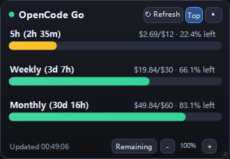

# OpenCode Go 桌面额度悬浮窗

[English](README.md) | **中文**

一个极小的 Windows 桌面悬浮窗，实时显示你的 **OpenCode Go** 额度 —— 5 小时、周、月三个用量窗口，常驻桌面、随开随用。




> 内存占用约 10 MB · 静置 CPU 0% · 原生 C#（无 Electron、无 WebView、无后台服务）

## 功能特性

- **实时额度计量** — 5 小时 / 周 / 月三个窗口，精确到美元金额（`$2.69/$12`）、进度条与重置倒计时。
- **随 OpenCode 启停** — 打开 OpenCode 桌面端时自动出现，关闭 OpenCode 后自动退出。
- **原生手感** — 随意拖动、自由缩放、无级调节透明度（25%–100%）、一键置顶。
- **迷你胶囊模式** — 双击折叠为单行：`Go | 5h:22% · Wk:66% · Mo:83%`。
- **剩余 / 已用一键切换** — 想看"还剩多少"还是"用了多少"，点一下就行。
- **手动 + 自动刷新** — 随时点击 `↻ 刷新`（或按 `F5`）；每次 AI 回复完成后与每 2 分钟也会静默同步。
- **中英双语界面** — 跟随系统显示语言自动选择，也可以在 `widget-settings.json` 中强制指定。

## 环境要求

- Windows 10 / 11
- [OpenCode](https://opencode.ai) **桌面端**（V2），已登录 OpenCode Console 并订阅 **OpenCode Go** 或 **Go Plus**
- 无需其他依赖。悬浮窗使用 Windows 自带的 .NET Framework 4.x 编译器构建。

## 安装步骤

1. **克隆本仓库**到任意目录（就是一个普通文件夹，不会向系统安装任何东西）：

   ```powershell
   git clone https://github.com/eittyneo/opencode-go-widget.git
   cd opencode-go-widget
   ```

2. **编译悬浮窗**（约 1 秒钟）：

   ```powershell
   powershell -ExecutionPolicy Bypass -File .\build.ps1
   ```

3. **安装 OpenCode 插件**（在你的 OpenCode 配置目录写入一个小加载器文件）：

   ```powershell
   powershell -ExecutionPolicy Bypass -File .\install.ps1
   ```

4. **重启 OpenCode。** 悬浮窗出现后，此后就会随 OpenCode 一起启动和退出。

如果你在 OpenCode 运行期间关掉了悬浮窗，在 OpenCode 中输入 `/widget`（或双击 `launch-widget.bat`）即可重新唤出。

## 使用说明

| 操作 | 方式 |
| --- | --- |
| 移动 | 按住卡片任意空白处拖动 |
| 缩放 | 拖动任意边缘或右下角斜纹手柄 |
| 立即刷新 | `↻ 刷新` 按钮 · `F5` · 右键菜单 |
| 剩余 / 已用 | `剩余` / `已用` 按钮 · 右键菜单 |
| 透明度 | `-` / `+` 按钮 · `Ctrl + 鼠标滚轮` · 右键菜单 |
| 迷你胶囊模式 | 双击卡片 · `▴` / `▾` 按钮 |
| 窗口置顶 | `Top` / `顶` 按钮（高亮 = 开启）· 右键菜单 |
| 关闭 | 右键 → *隐藏关闭悬浮窗*（用 `/widget` 重新打开） |

在 OpenCode 中：

- `/widget` — 重新打开悬浮窗。

## 工作原理

```text
 ┌─────────────────────────────┐        ┌──────────────────────────────────────┐
 │      OpenCode 桌面端         │ 启动   │  plugin.js（本仓库，运行在            │
 │        (OpenCode.exe)       ├───────►│  OpenCode 服务进程内）               │
 └──────────────┬──────────────┘        │                                      │
                │ 退出后                │  通过 OpenCode 自身的集成 API         │
                ▼                       │  读取你的 Console 登录凭证            │
 ┌─────────────────────────────┐        │               │                      │
 │  OpenCodeQuotaWidget.exe    │        │               ▼                      │
 │  • 本地 HTTP 客户端   ◄──────┼────────┤  GET https://opencode.ai/console/    │
 │  • OpenCode 退出即退出       │  HTTP  │      api/go/status                   │
 └─────────────────────────────┘ :19876 │  （你的令牌，由 OpenCode 在过期时续期）│
        （原生 C#，约 10 MB）            └──────────────────────────────────────┘
```

- 插件（`plugin.js`）运行在 OpenCode 服务进程里，通过 OpenCode 的集成 API 读取你的 Console 登录凭证，调用**与官方控制台页面相同的用量接口**，然后在本地 `http://127.0.0.1:19876/quota` 提供一个微型 JSON 接口，并缓存到 `quota-live.json`。
- 悬浮窗（`OpenCodeQuotaWidget.exe`）轮询这个本地接口，所以刷新既快又省资源。若 OpenCode 未运行，则依次回退到 `fetch-quota.mjs`（需要 Node ≥ 22.5）和本地缓存的 JSON。
- **完全独立实现。** 它**不读取** `@slkiser/opencode-quota` 的任何数据 —— 那是另一个优秀的 TUI 额度面板插件，两者可以同时使用，但代码路径互不相关。
- `/api/go/status` 是 OpenCode 控制台自身使用的接口，官方未将其列为公开 API，未来可能变动；若发生变动，悬浮窗会优雅降级（显示错误信息并保留最后一次缓存值）。

## 文件说明

| 文件 | 用途 |
| --- | --- |
| `OpenCodeQuotaWidget.cs` | 悬浮窗本体 —— 原生 C# / WinForms，GDI+ 绘制 |
| `OpenCodeQuotaWidget.exe` | 构建产物（由 `build.ps1` 生成，不提交到仓库） |
| `plugin.js` | OpenCode 插件：额度拉取、本地 HTTP 接口、悬浮窗生命周期、`/widget` 命令 |
| `fetch-quota.mjs` | 独立兜底拉取脚本（需要 Node ≥ 22.5） |
| `build.ps1` | 用系统自带的 .NET Framework 编译器构建 exe |
| `install.ps1` | 构建 + 把插件加载器写入 `~/.config/opencode/plugins/` |
| `launch-widget.bat` | 手动重新打开悬浮窗 |
| `quota-live.json` | 运行时缓存（运行时生成，不提交） |
| `widget-settings.json` | 你的悬浮窗偏好设置（运行时生成，不提交） |

## 配置

悬浮窗把状态保存在 exe 旁边的 `widget-settings.json`：

```jsonc
{
  "X": 2238, "Y": 1183,          // 记住的位置
  "Width": 320, "Height": 220,   // 记住的尺寸
  "Opacity": 0.75,               // 0.25 – 1.0
  "TopMost": true,               // 始终置顶
  "ShowRemaining": true,         // 启动时显示"剩余"还是"已用"
  "MiniMode": false,             // 启动时是否折叠为迷你条
  "SavedFullHeight": 220,
  "Language": "auto"             // "auto" | "en" | "zh"
}
```

一般无需手动编辑，悬浮窗会自动写入。删除该文件即可恢复默认。

## 卸载

1. 删除加载器文件 `%USERPROFILE%\.config\opencode\plugins\opencode-go-widget.js`（或 `install.ps1` 提示你的路径）。
2. 删除本仓库文件夹。
3. 完成 —— 没有安装其他任何东西。

## 常见问题

| 问题 | 解决办法 |
| --- | --- |
| 悬浮窗没有出现 | 确认 OpenCode 桌面端正在运行、且已执行 `install.ps1`。在 OpenCode 中输入 `/widget`。也可以直接启动 `OpenCodeQuotaWidget.exe` 观察现象。 |
| 显示错误或 `Console API error` | 在 OpenCode 中退出登录再重新登录，然后点 `↻ 刷新`。 |
| 数据看起来是旧的 | 点 `↻ 刷新`。若 OpenCode 很久没打开，令牌可能已过期 —— 打开一次 OpenCode 让它刷新令牌。 |
| 端口 19876 被占用 | 已有另一个实例在运行 —— 悬浮窗只允许单实例（互斥锁）。 |

## 隐私说明

- 你的 OpenCode 访问令牌始终留在本机：它从 OpenCode 自己的凭证库读取，并且只发送给 `opencode.ai`（与 OpenCode 本身调用的接口一致）。
- 无遥测、无统计、无第三方服务器。写入的文件只有 exe 旁的 `quota-live.json` 和 `widget-settings.json`。

## 许可证

[MIT](LICENSE)。与 OpenCode 官方无隶属关系。
